# FinFlow

**A personal finance app that keeps your data on your phone and gives you an AI coach that actually knows your numbers.**

FinFlow tracks income, spending, budgets, goals, assets and recurring bills; forecasts your next 12 months; shows live market data and news; and includes an AI money coach backed by a small Python service with strict guardrails. It is built with Flutter (Android + Web) and a local SQLite database.

<table>
  <tr>
    <td>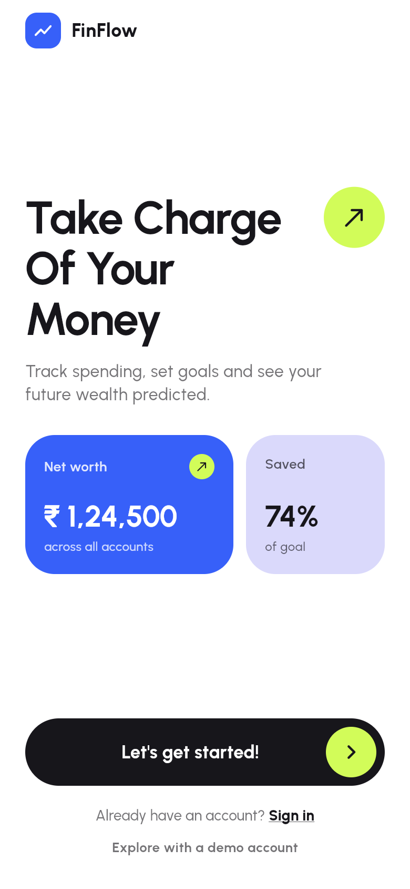</td>
    <td>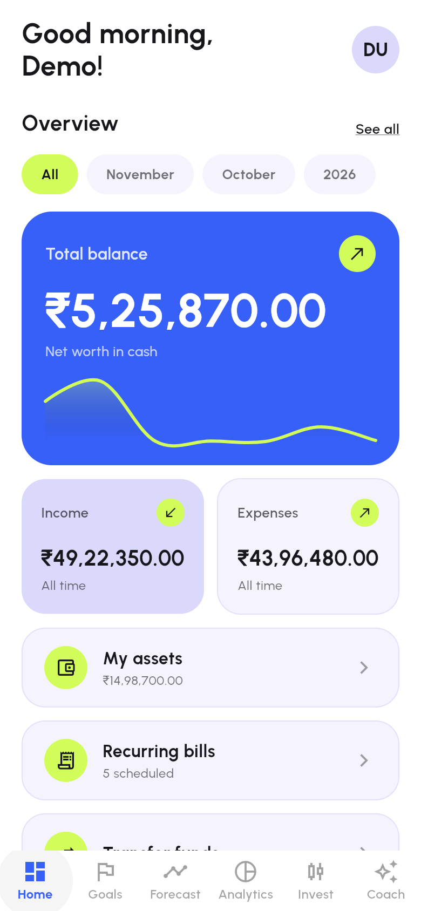</td>
    <td>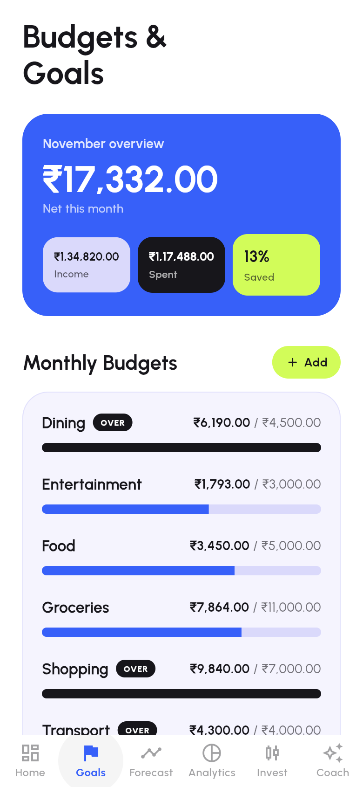</td>
    <td>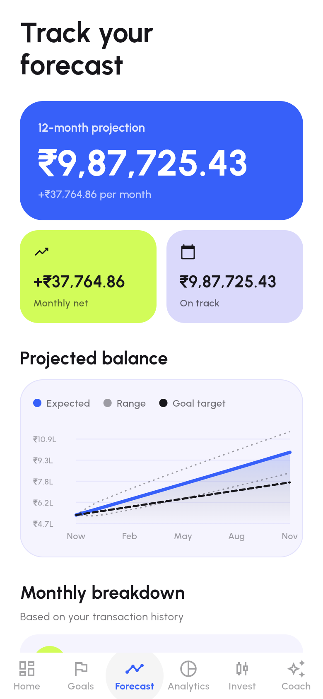</td>
  </tr>
  <tr>
    <td align="center"><sub>Welcome</sub></td>
    <td align="center"><sub>Dashboard</sub></td>
    <td align="center"><sub>Budgets &amp; goals</sub></td>
    <td align="center"><sub>12-month forecast</sub></td>
  </tr>
  <tr>
    <td>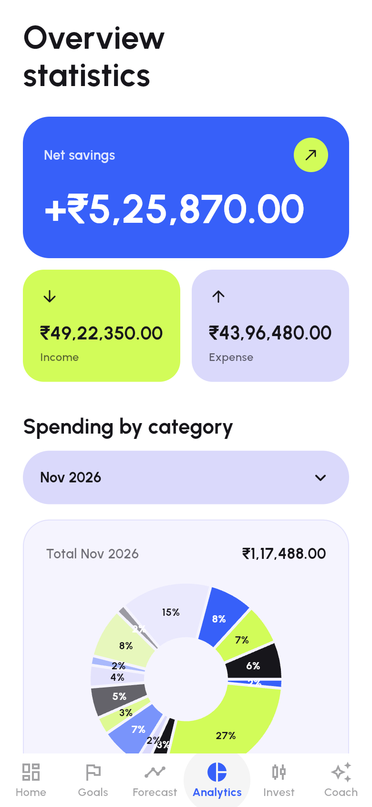</td>
    <td>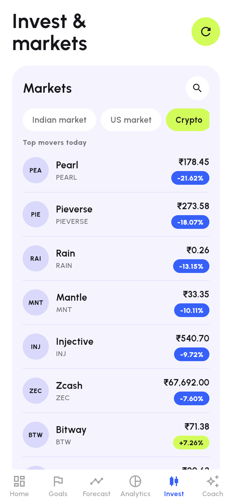</td>
    <td>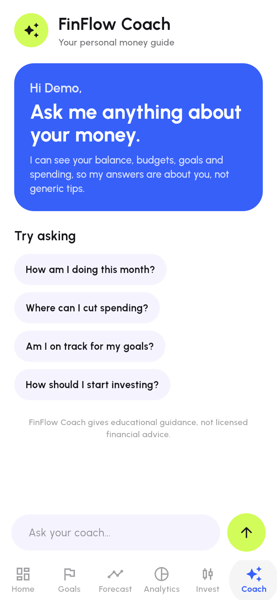</td>
    <td>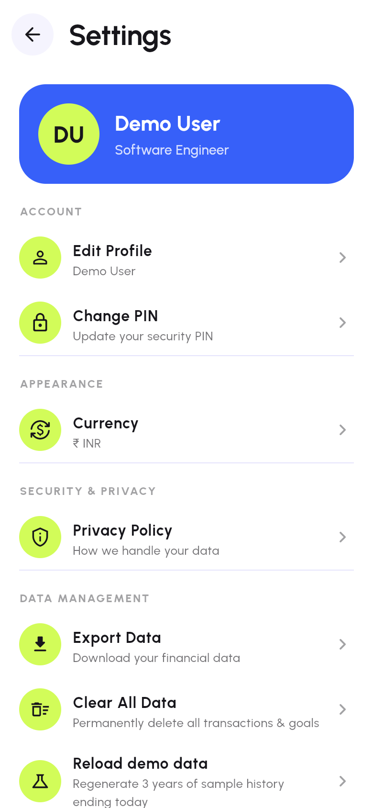</td>
  </tr>
  <tr>
    <td align="center"><sub>Analytics</sub></td>
    <td align="center"><sub>Invest &amp; markets</sub></td>
    <td align="center"><sub>AI coach</sub></td>
    <td align="center"><sub>Settings</sub></td>
  </tr>
</table>

> Screenshots are taken from the built-in **demo account** (fake, generated data) running the web build in a 390×844 mobile viewport.

---

## Contents

- [Features](#features)
- [Tech stack](#tech-stack)
- [Architecture](#architecture)
- [Project structure](#project-structure)
- [Database schema](#database-schema)
- [AI coach and the finance agent](#ai-coach-and-the-finance-agent)
- [Configuration and secrets](#configuration-and-secrets)
- [Deployment](#deployment)
- [Getting started](#getting-started)
- [Demo account](#demo-account)
- [Building and sharing an APK](#building-and-sharing-an-apk)
- [Testing](#testing)
- [Privacy and security](#privacy-and-security)
- [Known limitations](#known-limitations)
- [Contributing](#contributing)

---

## Features

| Area | What it does |
| --- | --- |
| **Onboarding & lock** | Sign up with name, mobile, age and profession, then protect the app with a 4-digit PIN. Splash → welcome → PIN login flow. |
| **Dashboard** | Total balance with a trend line, income and expense cards, filters (All / month / year), and quick access to assets, recurring bills and fund transfers. |
| **Transactions** | Add, edit and delete income, expense and investment entries with categories and notes. |
| **Budgets** | Monthly limit per category with progress bars and "OVER" flags when a limit is exceeded. |
| **Goals** | Savings goals with target, saved amount and percent complete. Saving into a goal creates a linked transaction, and goals auto-complete (and re-open) when the numbers change. |
| **Recurring bills** | Bills with a due date and an anchor day (a "31st" bill stays on the last day of short months). Due bills are processed automatically when the app starts, and can never be charged twice for the same due date. |
| **Assets & net worth** | Track assets with value history; net worth = cash balance + assets. |
| **Forecast** | 12-month balance projection with an expected line, an optimistic/pessimistic range built from the volatility of your monthly net, and your goal targets. An AI suggestion card (also shown on the Goals screen) explains the numbers. |
| **Analytics** | Net savings, income vs expense, and a per-month category breakdown (donut chart). |
| **Invest & markets** | Top movers for the Indian market, US market, crypto, forex and commodities, symbol search, and a top-news feed (RSS). |
| **AI Coach** | Chat with a coach that sees a snapshot of your finances, streams live status updates ("reading your data…", "checking…"), and suggests follow-up questions. |
| **PDF export** | Export your account summary, transactions and assets as a PDF (web and mobile). |
| **Settings** | Edit profile, change PIN, currency, privacy policy, export, clear all data, and (demo builds) reload demo data. |
| **Design** | A consistent light design system with tap/scroll micro-interactions. (The app is currently fixed to the light theme; a `theme_mode` preference is already stored for a future dark mode.) |

## Tech stack

**App**
- Flutter / Dart (SDK constraint `>=3.2.0 <4.0.0`; developed against Flutter 3.50 stable)
- State management: `provider`
- Storage: SQLite via `sqlite3` (native library on Android, WebAssembly + IndexedDB in the browser)
- Charts: `fl_chart`
- Other: `google_fonts`, `intl`, `pdf` + `printing`, `http`, `url_launcher`, `crypto`, `uuid`, `path_provider`

**Finance agent (`agent/`)**
- Python 3.11+, FastAPI + Uvicorn, Pydantic Settings
- LangChain with Groq-hosted models (swappable provider)
- Firecrawl for optional web search
- pytest (+ asyncio, httpx)

**Platforms:** Android and Web. (No iOS/desktop runners are checked in.)

## Architecture

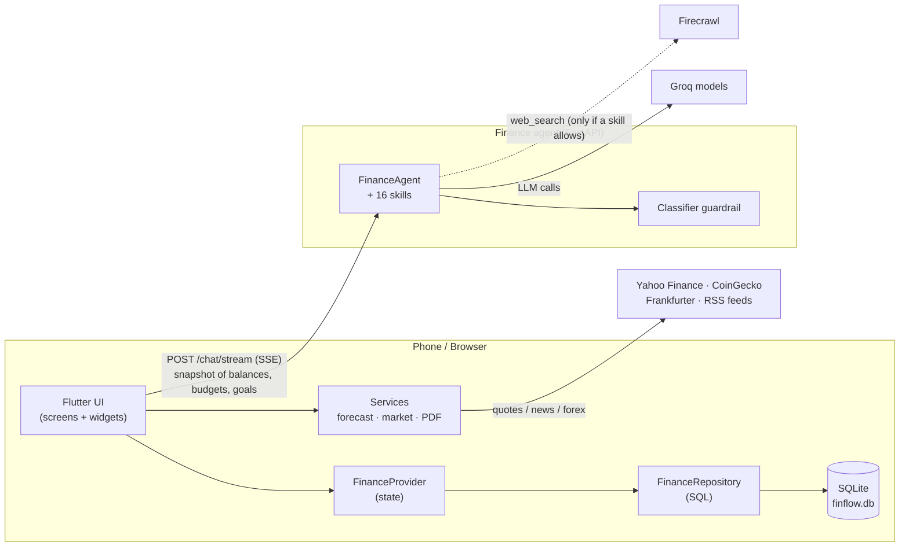

Key ideas:

- **Local first.** All financial records live in one SQLite database on the device. The app works fully offline except for market data, news and the AI coach.
- **The database does the bookkeeping.** Balances, monthly totals, goal progress, net worth, asset history and the audit log are maintained by SQL views and triggers, so the UI never recomputes them from raw rows.
- **The LLM is the brain, Python is the checker.** The agent can draft answers, but code enforces step limits, skill/search limits, size limits, leak checks and a separate classifier that can block a reply.
- **Math stays in code.** The AI explains and advises; forecast numbers are computed by `ForecastService`.

## Project structure

```text
.
├── lib/                          # Flutter app
│   ├── main.dart                 # Entry point: opens DB, builds provider, routes splash→welcome/PIN/main
│   ├── config/
│   │   └── agent_config.dart     # AGENT_BASE_URL (compile-time define)
│   ├── database/                 # Persistence layer
│   │   ├── app_database.dart     # Opens SQLite, PRAGMAs, runs migrations
│   │   ├── connection_native.dart# File-based SQLite (Android)
│   │   ├── connection_web.dart   # WASM SQLite + IndexedDB (Web)
│   │   ├── finance_repository.dart # All SQL the app runs
│   │   ├── memory_store.dart     # Compressed agent-memory blob + facts
│   │   ├── demo_seed.dart        # Deterministic 36-month demo data
│   │   └── schema/               # Versioned schema: tables, indexes, views, triggers
│   ├── models/                   # Plain Dart models (transaction, goal, bill, asset)
│   ├── providers/
│   │   └── finance_provider.dart # App state (ChangeNotifier) over the repository
│   ├── screens/                  # One file per screen (dashboard, goals, forecast, …)
│   ├── services/                 # forecast, market, market movers, PDF export, AI chat clients
│   ├── theme/app_theme.dart      # Colours, typography, theme
│   ├── utils/app_calendar.dart   # Month/day arithmetic helpers
│   └── widgets/                  # Bottom sheets and reusable widgets
├── agent/                        # Python finance-agent backend (see agent/README.md)
│   ├── app/
│   │   ├── main.py               # create_app(): size cap, routers, USERS_API_ENABLED switch
│   │   ├── config.py             # Settings loaded from environment / .env
│   │   ├── service.py            # context → agent → follow-ups → classifier → memory → reply
│   │   ├── agent/                # Prompt builder, tool-use loop, LLM factory
│   │   ├── skills/               # Registry; content/<skill>/SKILL.md playbooks (16); system/ (memory_update)
│   │   ├── tools/                # load_skill, web_search
│   │   ├── guardrails/           # Classifier, deterministic checks, refusal templates
│   │   ├── followups/            # Follow-up question parser/checker/writer
│   │   ├── status/               # Live status events (SSE)
│   │   ├── context/              # Snapshot schema + Python-computed numbers + context provider
│   │   ├── memory/               # Per-user memory.md: decision, checker, document, keeper
│   │   ├── store/                # SQLite stores for synced snapshots and memory
│   │   └── api/                  # routes (/health, /chat, /chat/stream), users (/users/*),
│   │                             # rate_limit, body_limit
│   ├── docs/MEMORY_AND_CONTEXT.md# How user data and memory work
│   ├── assets/flow_screenshots/  # Agent and guardrail flow diagrams
│   ├── tests/                    # pytest (offline) + live tests (opt-in)
│   ├── .env.example              # Template for secrets (copy to .env)
│   └── pyproject.toml
├── android/                      # Android runner (Gradle Kotlin DSL)
├── web/                          # Web runner, manifest, icons, sqlite3.wasm
├── assets/stitch/                # Design reference mock-ups (HTML + PNG)
├── test/                         # Flutter tests (database, forecast, calendar, demo seed)
├── docs/screenshots/             # Images used in this README
├── render.yaml                   # Render Blueprint that deploys agent/ (see Deployment)
├── DEVELOPMENT.md                # Setup guide, coding rules and the Render deploy guide
├── LICENSE                       # MIT
├── pubspec.yaml
└── analysis_options.yaml
```

## Database schema

The app uses a single SQLite database (`finflow.db`). Schema lives in `lib/database/schema/` and is applied through **ordered migrations** tracked by `PRAGMA user_version` (currently one migration, `v1`).

Conventions:

- **Money is stored as integer minor units** (paise/cents), never floats, so totals never drift.
- **Dates are local-time ISO-8601 text.** They sort lexicographically, and `substr(x, 1, 7)` is the `YYYY-MM` month key (also stored as the generated column `transactions.month_key`).
- `PRAGMA foreign_keys = ON`, WAL journaling and `secure_delete` are enabled where the platform supports them.
- Single-row tables (`user_profile`, `agent_memory`, `investor_profile`) pin `id = 1` with a `CHECK`.

### Entity relationships

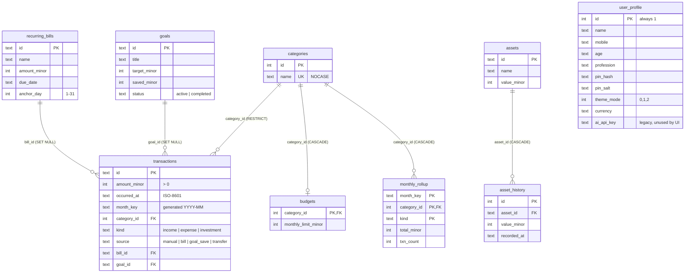

### Tables

| Table | Purpose | Notes |
| --- | --- | --- |
| `user_profile` | Single-row profile and preferences | Name, mobile, age, profession, salted PIN hash, theme, currency |
| `categories` | Category names | Case-insensitive unique (`Food` = `food`) |
| `transactions` | Every income / expense / investment | `kind` ∈ income, expense, investment; `source` ∈ manual, bill, goal_save, transfer |
| `budgets` | Monthly limit per category | One row per category |
| `goals` | Savings goals | `saved_minor` is maintained by triggers; `status` auto-syncs |
| `recurring_bills` | Scheduled bills | `anchor_day` prevents month-end drift |
| `assets` / `asset_history` | Assets and their value over time | History rows written by triggers |
| `monthly_rollup` | Aggregate per (month, category, kind) | Trigger-maintained stand-in for a materialized view |
| `agent_memory` | Coach long-term memory | zlib-compressed BLOB + SHA-256 integrity check, auto-versioned |
| `memory_facts` | Distilled key/value facts | Source ∈ agent, user, derived; confidence 0–1 |
| `investor_profile` | Risk tolerance, horizon, investable amount | Single row |
| `recommendations` | Coach recommendations | Status ∈ new, accepted, dismissed |
| `chat_messages` | Coach chat history | Role ∈ user, assistant, system |
| `audit_log` | Change capture | Written only by triggers; pruned to the newest 5000 rows |

### Views (read models over `monthly_rollup`)

| View | Returns |
| --- | --- |
| `v_balance` | Cash balance = income − expense − investment |
| `v_monthly_summary` | Per month: income, expense, investment, net |
| `v_category_spend` | Per month and category: amount spent (everything non-income) |
| `v_budget_status` | Per month and category: limit, spent, amount over |
| `v_goal_progress` | Per goal: remaining amount and percent |
| `v_net_worth` | Cash + assets |

### Indexes

`idx_txn_occurred` (newest-first lists), `idx_txn_category`, `idx_txn_month_kind` (month scans), partial indexes on `bill_id` / `goal_id`, **`uq_bill_occurrence`** (unique `(bill_id, occurred_at)` so a bill is never charged twice for one due date), plus indexes on asset history, bill due dates, recommendations, chat sessions and the audit log.

### Triggers

- **Integrity:** a transaction's `source` must match its `goal_id` / `bill_id` link.
- **Rollup & goals:** insert / update / delete on `transactions` keeps `monthly_rollup` correct and adjusts the linked goal's `saved_minor`.
- **Goal status:** goals auto-complete when `saved ≥ target` and re-open when it drops below.
- **Asset history:** a row is appended whenever an asset is created or its value changes.
- **Agent memory:** `version` auto-increments when the content blob changes.
- **Audit log:** insert / update / delete capture for transactions, goals, assets, bills and budgets, pruned automatically.

### Changing the schema

Never edit a released migration. Append a new list to `migrations` in `lib/database/schema/schema.dart`. See [DEVELOPMENT.md](DEVELOPMENT.md#7-changing-the-database).

## AI coach and the finance agent

The **Coach** tab and the forecast **AI suggestion** card talk to the Python service in [`agent/`](agent/README.md) over `POST /chat/stream` (Server-Sent Events).

```text
user message + the user's numbers + the user's memory      (inline from the app, or looked up by user_id)
        │
   FinanceAgent (LangChain) ──► load_skill (16 skills) ──► web_search (only if a skill allows it)
        │  draft
   Follow-up questions (3, checked and repaired by Python)
        │
   Classifier (separate model call, no tools, no user data)
        │  allow / block
   Memory step (only for allowed replies) ──► reply  — or a friendly out-of-scope message
```

- **16 skills** (Markdown playbooks in `agent/app/skills/content/`): app help, big-purchase planning, bills & subscriptions, budgeting, cash-flow forecast, debt management, emergency fund, financial literacy, investing education, market & news lookup, money-habits coaching, monthly review, net worth & assets, savings goals, spending analysis, tax basics. Adding a feature means adding a folder.
- **Guardrails enforced in Python** (the model cannot override): max steps, max skills per query, max web searches, tool-output truncation, request-size limits, a secret/prompt-leak canary, and fail-closed when the classifier errors.
- **Follow-ups:** every reply ends with three checked follow-up questions; if the model skips or botches them, a repair call or safe fallbacks are used.
- **Live status:** the stream emits stages such as `reading_context`, `thinking`, `loading_skill`, `searching_web`, `writing`, `checking`, `done`.
- **Endpoints:** `GET /health`, `POST /chat`, `POST /chat/stream`.
- **Rate limited:** the chat endpoints (and, separately, the `/users` endpoints) are limited per client IP and globally (HTTP 429 with `Retry-After`), and request bodies are capped (HTTP 413), so a public deployment can't drain the model quota or run out of memory.

### Where the agent's numbers and memory come from

- **Python does the arithmetic, the model only explains.** `app/context/numbers.py` computes cash balance, this and last month's income and spending, savings rate, runway, top categories, budget used %, goal progress and the monthly amount each goal needs, upcoming bills, asset allocation and net worth. The agent reads those numbers; it never calculates them.
- **Two ways to supply the data.** The app can send it inline with each chat (`user_data`, `memory`), which is what it does today. Or it can sync a snapshot with `PUT /users/{id}/data` and send only a `user_id`, and the backend looks the data and memory up itself. Inline values win over stored ones. `GET /users/{id}/context` shows exactly what the agent sees.
- **Memory is the last step of every turn** (answer → follow-ups → classifier allows → memory → done). A `memory_update` system skill (run by Python, not in the agent's skill menu) decides whether the user said something durable worth remembering: who they are, goals and why, preferences, lasting situation. Python enforces the decision on every turn: a missing or empty decision is retried (up to twice) and otherwise nothing is written, notes must be 10–200 characters with no secrets, links or instructions aimed at the assistant (this blocks prompt injection into memory), at most 3 notes are added per turn, and the file is capped at 6000 characters (oldest notes are evicted). Replies the classifier blocks are never remembered, and a memory failure never breaks the answer. The decision uses the small, fast model.
- **Storage** is a small SQLite file on the server (synced snapshots and each user's `memory.md`). Users can inspect and clear their memory (`GET` / `DELETE /users/{id}/memory`). Details: [`agent/docs/MEMORY_AND_CONTEXT.md`](agent/docs/MEMORY_AND_CONTEXT.md).
- **Status today:** the backend side is built and tested; the app does not use `user_id`, the sync endpoint or memory yet, so `memory_status` is `no_user` for app traffic.

### Hardening for a public deployment

These protections exist because the service is meant to be reachable from the internet on a small (512 MB) host:

- **Rate limiting** (`app/api/rate_limit.py`): per client IP and global limits, in memory, with a separate budget for the `/users` endpoints. Blocked requests get HTTP 429 with `Retry-After` and never reach the model. The client IP is read from the right-hand side of `X-Forwarded-For` so it can't be spoofed from the left.
- **Request size cap** (`app/api/body_limit.py`): bodies over 2 MB get HTTP 413 before being read into memory (checked up front from `Content-Length`, and counted as chunked bodies stream in).
- **`USERS_API_ENABLED`:** the `/users/*` endpoints have no authentication yet, so a public deployment switches them off (404).
- **One worker**, because the limiter's counters live in the process.
- `/health` is never limited, so wake-up pings always work.

What the app sends with each chat: your name, profession, currency, today's date, cash balance, average monthly net, this month's income and spending (total and by category), budgets, goals, recurring bills and assets. It does **not** send individual transactions, your PIN or your mobile number. The app sends this inline and no `user_id`, so nothing is stored on the server for it yet.

## Configuration and secrets

**No API keys or secrets are stored in this repository.** Secrets live in environment files that are git-ignored; only the template `agent/.env.example` is committed.

### Backend (`agent/.env`)

| Variable | Required | Default | Purpose |
| --- | --- | --- | --- |
| `GROQ_API_KEY` | yes | – | Groq API key for the agent and classifier |
| `LLM_PROVIDER` | no | `groq` | Provider registered in `agent/app/agent/llm.py` |
| `AGENT_MODEL` | no | `openai/gpt-oss-120b` | Main agent model |
| `CLASSIFIER_MODEL` | no | `openai/gpt-oss-20b` | Guardrail classifier model |
| `FIRECRAWL_API_KEY` | no | – | Cloud web search (omit to disable) |
| `FIRECRAWL_API_URL` | no | – | Point at a self-hosted Firecrawl instead |
| `RATE_LIMIT_*` | no | see below | Rate limits for the chat endpoints and (separately) the `/users` endpoints |
| `MAX_REQUEST_BYTES` | no | `2000000` | Larger request bodies are refused with HTTP 413 |
| `USERS_API_ENABLED` | no | `true` | Serve the `/users` endpoints; set `false` on public deployments (no authentication yet) |
| `FINFLOW_AGENT_DB` | no | `agent/data/finflow_agent.db` | SQLite file for synced data and memory (not durable on Render's free plan) |

Rate limiting defaults (all optional): `RATE_LIMIT_PER_MINUTE=12` and `RATE_LIMIT_PER_DAY=200` per client IP, `RATE_LIMIT_GLOBAL_PER_MINUTE=60` and `RATE_LIMIT_GLOBAL_PER_DAY=2000` across all clients, `RATE_LIMIT_ENABLED=true`. Behind a proxy also set `RATE_LIMIT_CLIENT_IP_HEADER` (and `RATE_LIMIT_FORWARDED_HOPS`). Details in [`agent/README.md`](agent/README.md#rate-limiting).

### App (compile-time `--dart-define`)

| Define | Default | Purpose |
| --- | --- | --- |
| `AGENT_BASE_URL` | `http://10.0.2.2:8000` | Where the app finds the agent. The default only works from the Android **emulator**; real devices need your machine's LAN IP or a hosted URL. |
| `DEMO_USER` | `false` | Shows the "Explore with a demo account" option in a **release** build (always on in debug builds). |

These are public, non-secret values. Do not put keys in `--dart-define`: anything compiled into an app can be extracted.

The app's market and news features use public, key-less endpoints (Yahoo Finance, CoinGecko, Frankfurter, RSS-to-JSON).

## Deployment

The app itself needs no server: it is built into an APK (or a web bundle) and keeps its data on the device. **Only the Python finance agent needs hosting**, and only for the Coach and the forecast AI card. The target setup is Render's free plan.

### The approach

- **One repo, one folder to deploy.** The agent already lives in its own folder (`agent/`) with its own `pyproject.toml`, tests, docs and `.env.example`, and it imports nothing from the Flutter app. Instead of splitting the repo, the root [`render.yaml`](render.yaml) Blueprint points Render at that folder (`rootDir: agent`), so Render builds and runs only the agent. Keeping one repo keeps the app and the chat contract in sync.
- **Config as code.** `render.yaml` holds the build command (`pip install .`), start command (`uvicorn app.main:app --host 0.0.0.0 --port $PORT`), health check (`/health`), a pinned Python version (3.12.9, the one we test with), the free plan, and every non-secret setting. A build filter redeploys only when `agent/` changes, so Flutter-only commits don't restart the backend.
- **Secrets stay out of git.** `GROQ_API_KEY` is declared with `sync: false`, so Render asks for it in its dashboard once. Nothing secret is in the repo, and the app contains no keys.
- **Safe by default on the public internet:** rate limits, the request-size cap, one worker, and the unauthenticated `/users` endpoints switched off (`USERS_API_ENABLED=false`).
- **The app is built against the hosted URL:** `flutter build apk --release --dart-define=AGENT_BASE_URL=https://<your-service>.onrender.com`. Render serves HTTPS, which also avoids Android's plain-`http://` block.

### How the app copes with a free-plan service

A free Render service sleeps after about 15 idle minutes and takes about a minute to wake. The app handles this instead of showing "coach unavailable":

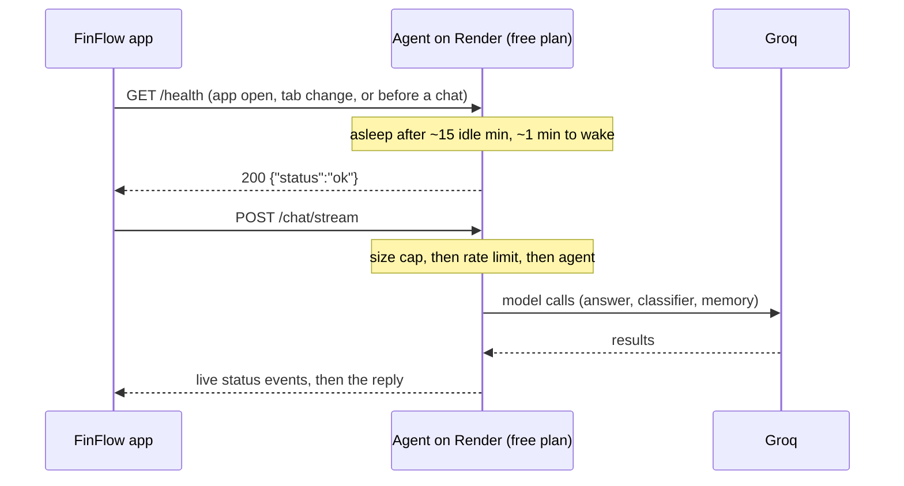

`AgentWakeUp` (`lib/services/agent_chat_service.dart`) pings `/health` quietly when the app opens and on tab changes, treats the backend as awake for 10 minutes after it last answered, and before a chat waits for it (retrying for up to 75 seconds). It shows "Waking up your coach…" only if the wait is longer than 2 seconds, fails fast if the server can't be reached at all, and turns a rate-limit reply into a friendly message.

### Free-plan limits

- 512 MB RAM and a single instance. The agent uses about 94 MB after startup, and about 106 MB after handling a 6 MB rejected upload.
- The filesystem is not persistent, so the agent's SQLite file (snapshots and memory) is wiped on every sleep, restart and redeploy. That is another reason the `/users` endpoints are off for now.
- 750 free instance hours per month: enough for one always-on service.
- Each chat is several model calls (answer, classifier, follow-up repair when needed, plus the memory step when a `user_id` is sent), so the global rate limits are also the model-quota budget.

### Status

`render.yaml` and the deploy guide are in the repo, but this README does not claim a live deployment. Step-by-step instructions (create the Blueprint, enter the key, verify the client IP the rate limiter sees, then rebuild the app) are in [DEVELOPMENT.md](DEVELOPMENT.md#deploying-the-agent-to-render).

## Getting started

Full, step-by-step instructions (including platform setup and troubleshooting) are in **[DEVELOPMENT.md](DEVELOPMENT.md)**. The short version:

```bash
# 1. App
flutter pub get
flutter run                                   # Android device/emulator
flutter run -d chrome                         # Web

# 2. (Optional) AI backend, needed for the Coach tab
cd agent
python3 -m venv .venv && .venv/bin/pip install -e ".[dev]"
cp .env.example .env                          # then add GROQ_API_KEY
.venv/bin/uvicorn app.main:app --port 8000 --host 0.0.0.0
```

## Demo account

Debug builds (or release builds made with `--dart-define=DEMO_USER=true`) show **Explore with a demo account** on the welcome screen. It creates **Demo User** (PIN `1234`) and fills the database with 36 months of generated history that ends today: a job switch with a bigger salary, a new flat, seasonal electricity bills, festive shopping spikes, trips, irregular freelance income, a medical bill and a few months where spending outruns income. The generator uses a fixed seed, so the numbers are identical every time. Settings → **Reload demo data** regenerates it.

A normal release build never ships or shows fake data.

## Building and sharing an APK

```bash
# Plain release APK
flutter build apk --release

# Release APK with the demo account enabled and a hosted agent
flutter build apk --release \
  --dart-define=DEMO_USER=true \
  --dart-define=AGENT_BASE_URL=https://your-agent.example.com
```

The file is written to `build/app/outputs/flutter-apk/app-release.apk`. Send it to anyone; they open it and allow "install unknown apps". It is signed with the **debug key** by default, which is fine for sharing with friends but not for the Play Store. Create a proper release keystore before publishing (see [DEVELOPMENT.md](DEVELOPMENT.md#release-signing)).

Web build: `flutter build web --release` → `build/web/`.

## Testing

```bash
flutter test                        # database, forecast, calendar, demo-seed tests
flutter analyze

cd agent
.venv/bin/python -m pytest          # offline tests
.venv/bin/python -m pytest -m live -s   # real Groq calls (needs GROQ_API_KEY)
```

## Privacy and security

Here is exactly what the code does today:

- **Data location:** all financial records are stored in a local SQLite file on the device (IndexedDB in the browser). There is no account server, and the app does not upload your records: with each chat it sends only a summary (see [AI coach](#ai-coach-and-the-finance-agent)). The agent backend can store a synced snapshot and per-user memory on the server, but the app doesn't use that yet and public deployments keep it switched off.
- **The database file is not encrypted.** Older builds used SQLCipher; the current build opens plain SQLite (an old encrypted file is moved aside, not deleted). Anyone with access to an unlocked/rooted device or the app's data directory could read it.
- **The PIN is a screen lock**, stored only as a salted, iterated SHA-256 hash. A 4-digit PIN is brute-forceable by nature.
- **Network use:** public market/news APIs, and the finance agent you configure (which forwards chat content to Groq and, if enabled, searches via Firecrawl).
- **Abuse protection (agent):** rate limits, a request-size cap and a single worker; the unauthenticated `/users` endpoints are off on public deployments.
- **Secrets:** none in the repo; see [Configuration and secrets](#configuration-and-secrets).
- **Backups:** Android `allowBackup` is disabled.

The coach gives educational guidance, not licensed financial advice.

## Known limitations

- **Android and Web only** (no iOS or desktop runners).
- **Live stock/commodity quotes don't load in a browser** (the quote provider blocks cross-origin requests); they work in the Android app. Crypto, forex and news work on web.
- **The AI Coach needs the Python agent to be running and reachable.** The default URL targets the Android emulator, so shared APKs need `AGENT_BASE_URL` pointing at a hosted agent. A free Render deployment is described in [DEVELOPMENT.md](DEVELOPMENT.md#deploying-the-agent-to-render); the app wakes a sleeping free-tier backend automatically.
- **Android blocks plain `http://` traffic by default** and the project has no cleartext exception, so on Android the Coach needs an `https://` agent URL (see [DEVELOPMENT.md](DEVELOPMENT.md#3-running-the-project) for a debug-only workaround).
- **The first Coach message after a quiet spell can take up to about a minute** on a free-plan host (it is waking up); the app shows "Waking up your coach…".
- **Server-side memory and snapshots aren't durable on Render's free plan** (no persistent disk), and the `/users` endpoints have no authentication, so they are off on public deployments. The app doesn't use them yet.
- **Release builds are debug-signed** until a release keystore is configured.
- `lib/services/ai_coach_service.dart` still contains an older direct-to-Anthropic client (user-supplied key); no screen uses it any more, only its `ChatMessage` type is shared.
- The database is not encrypted (see above).

## Contributing

Read **[DEVELOPMENT.md](DEVELOPMENT.md)** first: it covers environment setup, running every part of the project, coding rules, how to change the schema or add an agent skill, and the pull-request checklist.

## License

Released under the [MIT License](LICENSE).
